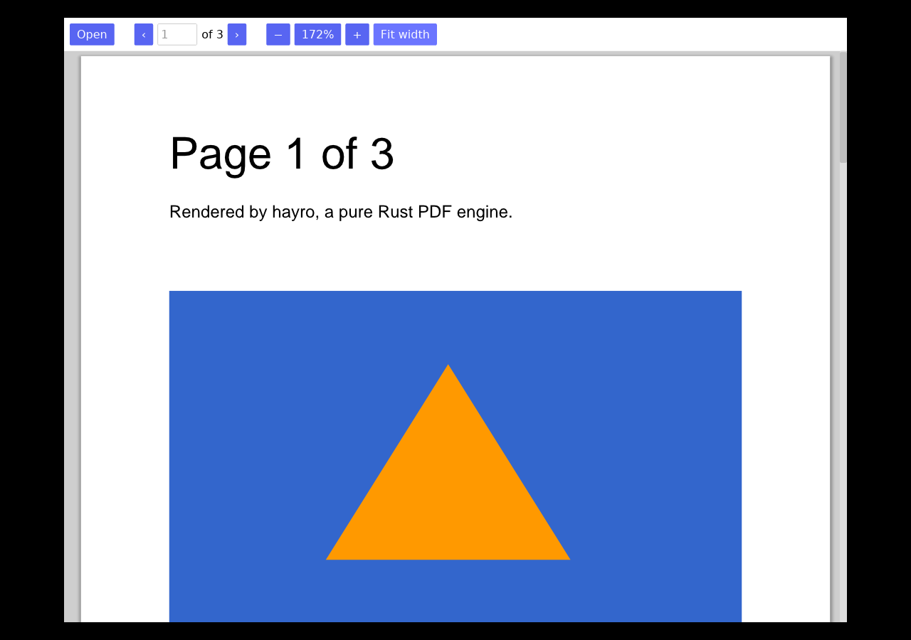

# Panna (पन्ना)

*Panna* is Hindi for both "page" and "emerald".


An offline PDF viewer and editor for Windows, macOS and Linux, written in memory-safe Rust.
It has no cloud features, no accounts and no telemetry. The app never touches the network.

**Status:** early preview. It opens PDFs and supports continuous scrolling, zoom, fit width
and page navigation. Annotation and form filling come next. See [docs/FEATURES.md](docs/FEATURES.md).



## Build and run

You need Rust 1.88 or newer (install it from [rustup.rs](https://rustup.rs)).

```sh
cargo run --release -p panna -- path/to/file.pdf
```

Linux builds need no system libraries to compile. At runtime the app uses Wayland, or X11
with `libxkbcommon-x11`, which every desktop install already has.

### Keyboard shortcuts

| Action | Shortcut (Cmd on macOS) |
|---|---|
| Open | Ctrl+O |
| Zoom in / out | Ctrl+= / Ctrl+- |
| Actual size | Ctrl+0 |
| Fit width | Ctrl+2 |
| Next / previous page | Page Down / Page Up |

You can also drop a PDF onto the window to open it.

## Linux: KDE Plasma and GNOME

A single build works natively on both desktops. Nothing needs to be built separately for each:

- **Native Wayland** with fractional scaling, plus an X11 fallback.
- **Your desktop's own file dialog** (KDE's or GNOME's) through XDG portals.
- **Follows light and dark mode** from the desktop setting.
- **Menu entry, icon and "Open with"** for PDFs through the `.desktop` file and AppStream metadata.

Install options:

- **Flatpak** (recommended; sandboxed with no network and no file access beyond the files you open):
  see `packaging/linux/io.github.nishantnkumar_cell.Panna.yml`. CI builds a `.flatpak` bundle.
- **Local install** to `~/.local`: `packaging/linux/install-local.sh`.
- **Tarball** for x86_64 and ARM64 from the CI artifacts.

## Releases

CI builds Linux (x86_64 and ARM64), Windows (x86_64 and ARM64), a universal macOS app and a
Flatpak on every push. The macOS app is ad-hoc signed. Opening it the first time needs
right-click → Open until it's notarised with an Apple developer account.

## Security

See [SECURITY.md](SECURITY.md) and [docs/ARCHITECTURE.md](docs/ARCHITECTURE.md).

```sh
cargo test --workspace                 # unit + corrupted-file tests
cargo deny check                       # advisories, licenses, banned network crates
cd fuzz && cargo +nightly fuzz run open_render
```

## Layout

```
crates/panna-core   parsing, rendering, limits, render worker (no GUI)
crates/panna    iced desktop app
fuzz/             fuzz targets
packaging/        Linux (Flatpak, .desktop, AppStream) and macOS bundle files
```
