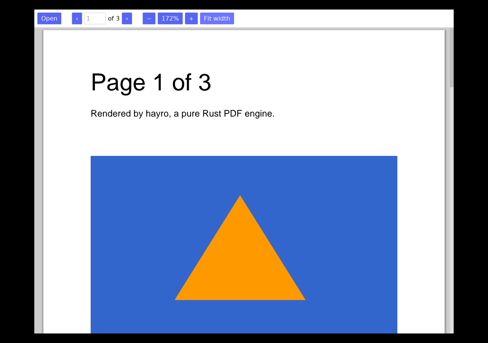

# Panna (पन्ना)

*Panna* is Hindi for both "page" and "emerald".


An offline PDF viewer and editor for Windows, macOS and Linux, written in memory-safe Rust.
It has no cloud features, no accounts and no telemetry. The app never touches the network.

**Status:** early preview. It opens PDFs and supports continuous scrolling, zoom, fit width
and page navigation. Annotation and form filling come next. See [docs/FEATURES.md](docs/FEATURES.md).



## Build and run

You need Rust 1.94 or newer (install it from [rustup.rs](https://rustup.rs)).

```sh
cargo run --release -p panna -- path/to/file.pdf
```

Linux builds need the ALSA headers to compile, for recording and playing spoken comments
(`libasound2-dev` on Debian and Ubuntu, `alsa-lib-devel` on Fedora). At runtime the app uses
Wayland, or X11 with `libxkbcommon-x11`, and ALSA's `libasound2`, which every desktop install
already has.

### Keyboard shortcuts

| Action | Shortcut (Cmd on macOS) |
|---|---|
| Open | Ctrl+O |
| Zoom in / out | Ctrl+= / Ctrl+- |
| Actual size | Ctrl+0 |
| Fit width | Ctrl+2 |
| Next / previous page | Page Down / Page Up |
| Preferences | Ctrl+, |

Help › Keyboard shortcuts lists the rest and lets you change them.

You can also drop a PDF onto the window to open it.

## Linux: KDE Plasma and GNOME

A single build works natively on both desktops. Nothing needs to be built separately for each:

- **Native Wayland** with fractional scaling, plus an X11 fallback.
- **Your desktop's own file dialog** (KDE's or GNOME's) through XDG portals.
- **Follows light and dark mode** from the desktop setting.
- **Menu entry, icon and "Open with"** for PDFs through the `.desktop` file and AppStream metadata.

Install options:

- **Flatpak** (recommended; sandboxed with no network and no file access beyond the files you open):
  see `packaging/linux/io.github.nishantnkumar_cell.Panna.yml`. CI builds a `.flatpak` bundle.
- **Local install** to `~/.local`: `packaging/linux/install-local.sh`.
- **Tarball** for x86_64 and ARM64 from the CI artifacts.

## Download

Preview builds are on the [Releases page](https://github.com/nishantnkumar-cell/Panna/releases).
No GitHub account is needed. They are marked **Pre-release**: Panna is an early preview, so
keep a copy of any PDF you care about.

| System | File |
| --- | --- |
| Windows, Intel or AMD | `panna-windows-x86_64-setup.exe` (installer) or `panna-windows-x86_64.zip` (portable) |
| Windows, ARM | `panna-windows-aarch64-setup.exe` or `panna-windows-aarch64.zip` |
| macOS, Apple Silicon and Intel | `panna-macos-universal.dmg` |
| Linux, Flatpak | `panna.flatpak`: `flatpak install --user panna.flatpak` |
| Linux, tarball | `panna-linux-x86_64.tar.gz` or `panna-linux-aarch64.tar.gz` |

Check a download against `SHA256SUMS` from the same release:
`sha256sum -c SHA256SUMS --ignore-missing` (`shasum -a 256 -c SHA256SUMS` on macOS).

If Windows SmartScreen warns about an unsigned build, click **More info**, then
**Run anyway**. The macOS app is ad-hoc signed. Opening it the first time needs
right-click → Open until it's notarised with an Apple developer account.

CI also builds every one of these on each push; see [docs/RELEASING.md](docs/RELEASING.md).

To make Panna the default PDF app:

- **Windows:** run `panna-windows-…-setup.exe`. It installs for you alone, with no administrator
  rights needed, and its last page opens Settings → Default apps at Panna's entry, since
  Windows lets only you choose the default.
- **macOS:** open `panna-macos-universal.dmg` and drag Panna to Applications. Then select any
  PDF in Finder, choose File → Get Info, pick Panna under "Open with" and click Change All.
- **Linux:** the menu entry registers Panna for PDFs; choose it as the default in your
  desktop's settings (Default Applications in KDE, Default Apps in GNOME).

## Security

See [SECURITY.md](SECURITY.md) and [docs/ARCHITECTURE.md](docs/ARCHITECTURE.md).

```sh
cargo test --workspace                 # unit + corrupted-file tests
cargo deny check                       # advisories, licenses, banned network crates
cd fuzz && cargo +nightly fuzz run open_render
```

## Layout

```
crates/panna-core   parsing, rendering, limits, render worker (no GUI)
crates/panna    iced desktop app
fuzz/             fuzz targets
packaging/        Linux (Flatpak, .desktop, AppStream) and macOS bundle files
```
